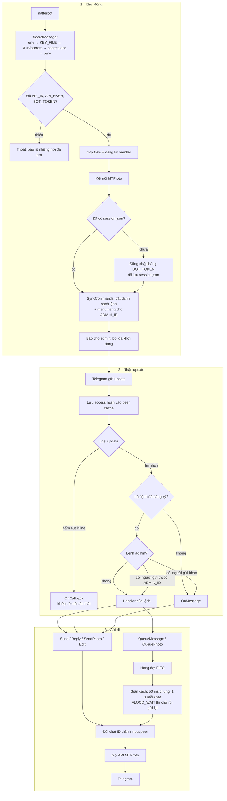

# telegramMTP

Thư viện Go nói chuyện với Telegram trực tiếp qua **MTProto** (không qua Bot API HTTP), với cách dùng gọn như [Telethon](https://github.com/LonamiWebs/Telethon). Bên dưới là [gotd/td](https://github.com/gotd/td); `telegramMTP` giấu các kiểu TL thô sau vài hàm dễ nhớ.

Kèm theo là **natterbot**: một bot chạy được ngay, mỗi lệnh minh hoạ một tính năng của thư viện.

```go
bot, _ := mtp.New(mtp.Config{APIID: id, APIHash: hash, BotToken: token, AdminIDs: []int64{123456789}})

bot.OnCommand("ping", "Kiểm tra bot", func(c *mtp.Context) error {
    _, err := c.Reply("pong")
    return err
})

bot.Run(ctx)
```

## Tính năng

| Tính năng | Telethon | telegramMTP |
| --- | --- | --- |
| Gửi tin | `client.send_message(chat, text)` | `bot.SendMessage(ctx, chatID, text)` · `c.Send(text)` |
| Trả lời (quote) | `event.reply(text)` | `c.Reply(text)` · `mtp.ReplyTo(id)` |
| Gửi ảnh | `client.send_file(chat, file)` | `bot.SendPhoto(ctx, chatID, mtp.PhotoFile(path), caption)` |
| Bàn phím lệnh | `Button.text(...)` | `mtp.WithKeyboard(bot.CommandKeyboard(3))` |
| Nút inline | `Button.inline(...)` + `events.CallbackQuery` | `mtp.WithInline(...)` + `bot.OnCallback(prefix, h)` |
| Bắt lệnh | `@client.on(events.NewMessage(pattern="/start"))` | `bot.OnCommand("start", "mô tả", h)` |
| Hàng đợi | tự viết | `bot.QueueMessage(chatID, text)` |
| Bí mật | tự viết | package `secret` |
| Admin | tự viết | `Config.AdminIDs` + `bot.OnAdminCommand(...)` |
| Danh sách lệnh | `SetBotCommandsRequest` | tự đồng bộ khi khởi động |

Chat được định danh bằng **một số `int64`** theo đúng quy ước của Telethon và Bot API: user là số dương, nhóm thường là số âm, kênh/supergroup là `-100<id>`. Thư viện tự lo access hash.

## Chạy nhanh

Cần Go 1.25+ và ba giá trị: `API_ID`, `API_HASH` (lấy ở <https://my.telegram.org/apps>) và `BOT_TOKEN` (lấy từ @BotFather).

```powershell
Copy-Item .env.example .env   # rồi điền giá trị vào .env
go mod tidy
go build -trimpath -ldflags "-s -w" -o bin/natterbot.exe ./cmd/natterbot
.\bin\natterbot.exe
```

Build cho Linux từ Windows:

```powershell
$env:GOOS = "linux"; $env:GOARCH = "amd64"; $env:CGO_ENABLED = "0"
go build -trimpath -ldflags "-s -w" -o bin/natterbot-linux-amd64 ./cmd/natterbot
```

### ADMIN_ID

`ADMIN_ID` là ID Telegram của những người được chạy lệnh admin, cách nhau bằng dấu phẩy: `ADMIN_ID=111111111,222222222`.

Chưa biết ID của mình? Chạy bot, nhắn `/id`, lấy số "User ID" đặt vào `ADMIN_ID` rồi khởi động lại. Với người không phải admin, lệnh admin cư xử y hệt một lệnh không tồn tại.

### Danh sách lệnh của natterbot

| Lệnh | Việc làm | Tính năng minh hoạ |
| --- | --- | --- |
| `/start` | Chào và hiện bàn phím lệnh | sendMessage, CommandKeyboard |
| `/help` | Liệt kê lệnh | command list |
| `/id` | Xem User ID / Chat ID | replyMessage |
| `/ping` | Kiểm tra bot còn sống | replyMessage |
| `/echo <nội dung>` | Nhắc lại nội dung | replyMessage |
| `/menu` | Menu nút bấm | InlineKeyboard |
| `/photo` | Gửi ảnh mẫu | addImage |
| `/queue [n]` | Xếp n tin vào hàng đợi | queueMessage |
| `/hide` | Ẩn bàn phím lệnh | CommandKeyboard |
| `/stats` *(admin)* | Uptime, độ dài hàng đợi | ADMIN_ID |
| `/say <chat_id> <nội dung>` *(admin)* | Gửi tin tới chat khác | ADMIN_ID, queueMessage |

Danh sách này được đẩy lên Telegram mỗi lần bot khởi động, nên gõ `/` trong chat là thấy. Admin thấy thêm các lệnh admin.

## Triển khai bằng Docker

```powershell
Copy-Item .env.example .env   # điền API_ID, API_HASH, BOT_TOKEN, ADMIN_ID
docker compose up -d --build
docker compose logs -f natterbot
```

Compose từ chối khởi động nếu thiếu một trong bốn giá trị trên. File phiên (`session.json`, chứa khoá đăng nhập MTProto) nằm trong volume `natterbot-data` nên khởi động lại không phải đăng nhập lại. Container chạy bằng user không phải root, hệ thống file chỉ đọc, không mở cổng nào.

## SecretManager

Package `secret` tìm một khoá (ví dụ `BOT_TOKEN`) theo thứ tự, gặp đâu lấy đó:

1. biến môi trường `BOT_TOKEN`
2. file do biến `BOT_TOKEN_FILE` trỏ tới
3. Docker/Kubernetes secret: `/run/secrets/bot_token`
4. kho mã hoá `secrets.enc` (cần `SECRET_MASTER_KEY`)
5. file `.env`

Giá trị rỗng được coi là chưa đặt. Khi thiếu, lỗi liệt kê đủ những nơi đã tìm. Log chỉ ghi *nguồn* của bí mật và giá trị đã che (`12****ab`), không bao giờ ghi giá trị thật.

Kho mã hoá dùng AES-256-GCM, khoá dẫn xuất từ mật khẩu bằng PBKDF2-HMAC-SHA256 (600 000 vòng):

```powershell
$env:SECRET_MASTER_KEY = "<mật khẩu của bạn>"
.\bin\natterbot.exe secret set BOT_TOKEN    # giá trị nhập qua stdin, không lọt vào lịch sử shell
.\bin\natterbot.exe secret list
.\bin\natterbot.exe secret rm BOT_TOKEN
```

## Sơ đồ luồng



Mỗi update chạy trong một goroutine riêng, nên handler chậm không chặn các update khác. Hàng đợi gửi tuần tự bằng một worker duy nhất.

## Cấu trúc

```
mtp/              thư viện: client, router, gửi tin, bàn phím, ảnh, hàng đợi, admin
secret/           SecretManager: tra cứu nhiều tầng + kho mã hoá
cmd/natterbot/    bot mẫu và CLI quản lý bí mật
Dockerfile, docker-compose.yml
```

## Quy ước commit và nhánh

Commit theo [Conventional Commits](https://www.conventionalcommits.org/), được kiểm tra bằng commitlint qua hook `commit-msg` của husky (chạy `npm install` một lần để bật hook) và qua CI trên pull request.

```
feat(sendMessage): add SendMessage with send options
```

Mỗi tính năng nằm trên một nhánh `feat/<tên>`, merge vào `main` bằng `--no-ff`:
`feat/sendMessage`, `feat/CommandKeyboard`, `feat/InlineKeyboard`, `feat/addImage`, `feat/replyMessage`, `feat/queueMessage`, `feat/SecretManager`, `feat/adminID`, `feat/commandList`, `feat/bot`.

## Giới hạn hiện tại

- Chỉ đăng nhập bằng **bot token**. Đăng nhập tài khoản người dùng (số điện thoại + mã) chưa được bọc.
- Phần định dạng hỗ trợ văn bản thường và HTML (`mtp.HTML()`), chưa có Markdown.
- Việc gì chưa được bọc có thể gọi thẳng qua `bot.API()` (client gotd thô).
