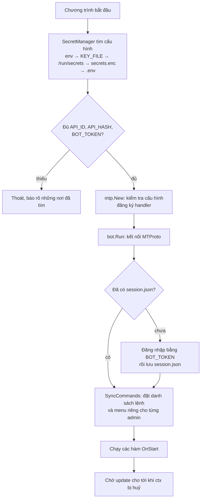
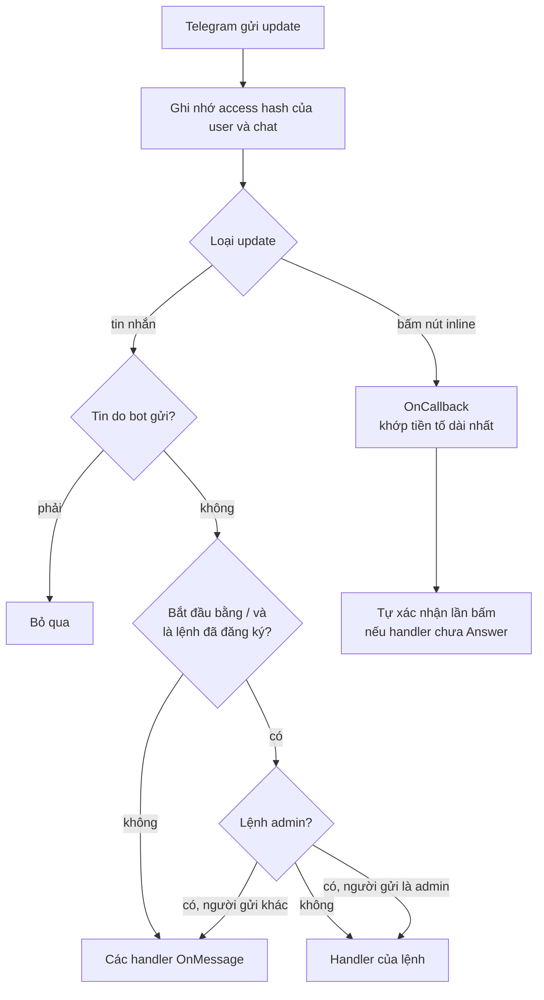
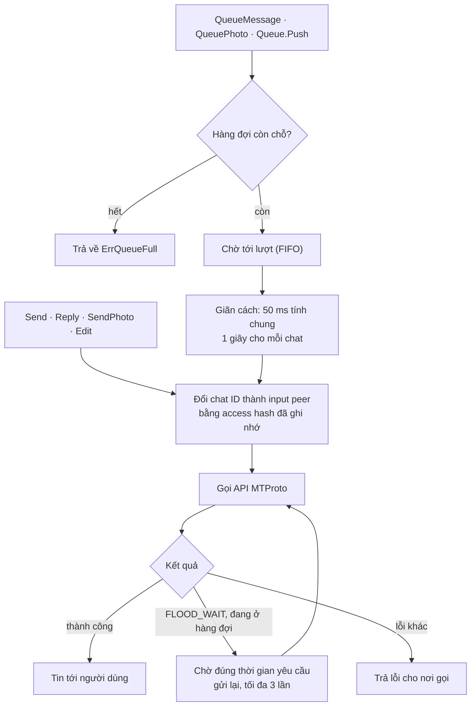
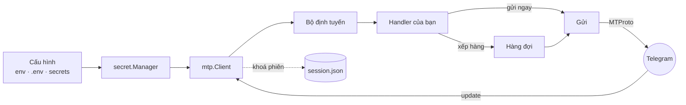

# Sơ đồ luồng

Ba giai đoạn trong vòng đời của bot: khởi động, nhận update, và gửi đi.

## 1. Khởi động

Hàng đợi gửi bắt đầu chạy ngay sau khi đăng nhập, trước `SyncCommands`. Đồng bộ danh sách lệnh thất bại chỉ ghi cảnh báo; hàm `OnStart` trả về lỗi thì dừng bot.

## 2. Nhận update

Mỗi update chạy trong một goroutine riêng. Lỗi và panic của handler được ghi log, không làm bot dừng. Trong nhóm, lệnh gửi đích danh bot khác (`/ping@botkhac`) bị bỏ qua trước khi tới bước định tuyến.

## 3. Gửi đi

Gửi trực tiếp (`Send`, `Reply`…) không tự chờ `FLOOD_WAIT`: lỗi được trả thẳng về handler. Chỉ đường đi qua hàng đợi mới tự chờ và gửi lại.

## Toàn cảnh

